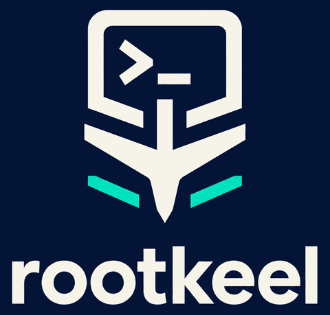

<p align="center"></p>

# Rootkeel

Self-hostable shared terminals for developers and their agents.

Rootkeel lets you open a terminal session on your own Linux machines from anywhere: from another
computer with `rt attach`, or from any browser, including a phone. Sessions keep running when you
disconnect, so a long job, a build or a coding agent carries on while you are away, and you pick
it up again from wherever you are.

You run the server yourself. It is three small components: a TLS front door (nginx), the broker
that checks every request, and a relay (frp) that your machines dial out to. Run them as one Docker
Compose stack on a single host, or on Kubernetes with the Helm chart. Machines need only outbound
HTTPS; nothing on them listens on the network.

```
   your browser / rt attach                          your Linux machines
            │  HTTPS                                    │  outbound WSS only
            ▼                                           ▼
   ┌─────────────────────── your server (Compose or Helm) ───────────────────────┐
   │  nginx (TLS) ──► broker (grants, sign-in, policy) ◄──► relay (frps) ◄────────┤
   └──────────────────────────────────────────────────────────────────────────────┘
                                                        │
                              agent (frpc) ──► Zellij web server ──► your shell
```

- **One owner, one credential.** Setup generates a random owner credential. `rt login` asks for it
  once and keeps it in a file only you can read. There are no accounts and no third-party sign-in.
- **Session grants.** Each terminal is opened through a grant for one session on one machine.
  A browser signs in to a grant once; revoking the grant closes every connection to it at once.
- **Several machines.** Enroll as many Linux machines as you like and name them; pick one with
  `--machine`.
- **Built on [Zellij](https://zellij.dev).** Sessions are ordinary Zellij sessions running as an
  ordinary user on your machine. Detach with `Ctrl+Alt+g`, then `d`.

## Quick start

This is the short version for readers who have run servers before. The full step-by-step guide,
with prerequisites, expected output and troubleshooting, is [docs/install.md](docs/install.md); to
run the server on Kubernetes instead, see [docs/helm.md](docs/helm.md).

Before you start you need:

- a Linux server (x86-64 or ARM64) with a public IPv4 address, Docker, Git, Python 3 and OpenSSL,
  with inbound TCP port 443 open;
- three DNS `A` records pointing at it, for example `term.example.com`, `owner.term.example.com`
  (always `owner.` followed by the first name) and `term-relay.example.com`;
- one TLS certificate covering all three names, as a full-chain PEM file and an unencrypted key
  file, for example from Let's Encrypt.

**On the server:**

```sh
sudo git clone https://github.com/rootkeel/rootkeel.git /opt/rootkeel-server && cd /opt/rootkeel-server
sudo git checkout v0.1.0                    # the release you run
sudo install -D -m 600 server/example.env /etc/rootkeel/rootkeel.env
sudoedit /etc/rootkeel/rootkeel.env         # hostnames, certificate paths, and the release's image digests
sudo scripts/prepare.sh /etc/rootkeel/rootkeel.env
sudo scripts/compose.sh /etc/rootkeel/rootkeel.env up -d
sudo cat /srv/rootkeel/prod/owner           # the owner credential, for rt login
```

**On your computer** (macOS or Linux; Windows through WSL), with `rt` from the release's downloads
installed as `~/.local/bin/rt` ([docs/install.md, step 9](docs/install.md#9-install-rt-on-your-computer)):

```sh
rt login --url https://term.example.com     # paste the owner credential once
rt enrollment --name devbox                 # prints a one-use enrollment code
rt enroll machine.json                      # enter the code; writes the machine credential
scp machine.json alice@devbox:              # copy it privately to the machine to share
```

**On the Linux machine to share** (Debian 13 or Ubuntu 24.04), as `alice`, after unpacking the
release's agent bundle `rootkeel-agent-0.1.0-linux.tar.gz` and changing into it:

```sh
sudo agent/install.sh alice ~/machine.json
```

**From your computer, anywhere:**

```sh
rt attach main                              # in a terminal (needs Zellij 0.45.1), or:
rt grant main                               # prints a URL and a session credential for a browser
rt grant main --qr                          # or a QR code: a phone that scans it opens the terminal, signed in
```

## Downloads

Each [release](https://github.com/rootkeel/rootkeel/releases) carries:

| What | Runs on |
|---|---|
| Broker and relay images, `ghcr.io/rootkeel/{broker,relay}:<version>` | Linux servers with Docker, `linux/amd64` and `linux/arm64` |
| `rt`, a standalone executable | macOS (Apple silicon and Intel), Linux (x86-64 and ARM64); Windows through WSL |
| The agent bundle (`agent/install.sh` and its files) | Debian 13 and Ubuntu 24.04, x86-64 and ARM64 |

with checksums, SBOMs and build provenance. `rt attach` also needs Zellij 0.45.1 on your computer.
Details are in [docs/install.md](docs/install.md#release-downloads). Everything can also be built
from a checkout.

## Documentation

- [Install](docs/install.md): server, DNS, certificate, first machine.
- [Install on Kubernetes](docs/helm.md): the Helm chart, in place of Docker Compose.
- [Architecture](docs/architecture.md): the components and how a request flows.
- [Configuration](docs/configuration.md): every setting of the server and the agent.
- [Security](docs/security.md): what Rootkeel protects, and what it does not.
- [Operations](docs/operations.md): backups, upgrades, rotating the owner credential, revoking access.

## Project status

Rootkeel is young. Two ways to run the server are supported: the single-host Docker Compose
deployment described here, and the Helm chart for Kubernetes. Interfaces may still change between
releases; read the release notes before upgrading.

## Contributing

Contributions are welcome. Read [CONTRIBUTING.md](CONTRIBUTING.md) first: contributions are
accepted under a contributor licence agreement. Report security issues privately as described in
[SECURITY.md](SECURITY.md).

## Licence

Rootkeel is free software under the GNU Affero General Public License, version 3 only
([LICENSE](LICENSE)). Third-party components and their licences
are listed in [THIRD_PARTY_NOTICES.md](THIRD_PARTY_NOTICES.md).
